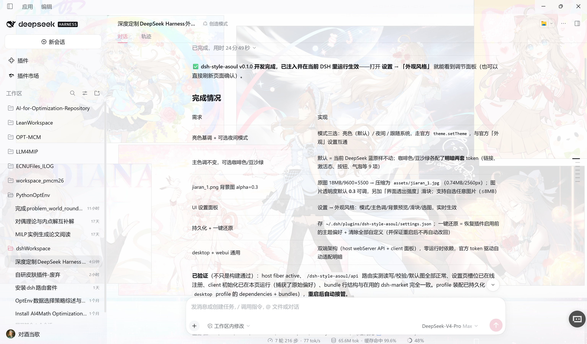

# dsh-style-asoul

A-SOUL 外观风格插件（v0.2）——给 DeepSeek Harness 换一套你喜欢的外观：亮色基调 + 可选夜间模式，主色调 6 款可选（默认蓝 / 咖啡色 / 豆沙绿 / 贝拉 / 嘉然 / 乃琳），支持自定义背景图（默认嘉然壁纸，透明度 0.3），内置嘉然桌宠挂件（TodoList 面板），带设置面板、持久化与一键还原。

适用于 **DSH desktop（桌面端）** 与 **webui（网页端）**。

效果：


## 功能

| 功能 | 说明 |
| --- | --- |
| 模式 | 亮色（默认）/ 夜间 / 跟随系统 |
| 主色调 | 默认（当前 DeepSeek 蓝，不变）/ 咖啡色 / 豆沙绿 / 贝拉 `#BD7D74` / 嘉然 `#E799B0` / 乃琳 `#576690`——只替换主色相关 token（链接、激活态、按钮、气泡），每款明暗两套配色齐备 |
| 背景图 | 内置嘉然壁纸（assets/jiaran_1.jpg，由 9600×5500 原图压缩为 2560px），来源[bilibili](https://www.bilibili.com/opus/1258687238954287128)；可自选任意图片（≤8MB）；图片透明度默认 **0.3**、可调；"界面透出强度"控制界面底色让背景透出的程度 |
| 设置面板 | 设置 → 「外观风格」页：所有选项可视化调节，实时生效 |
| 持久化 | 配置存于 `~/.dsh/plugins/dsh-style-asoul/settings.json`（经 host API，desktop/webui 通用） |
| 一键还原 | 一键恢复插件启用前的主题偏好、主色调与背景，并清除自定义配置 |
| 嘉然桌宠（v0.2） | 右上角悬浮宠物：左键拖动、右键待办面板；形象参考[桌宠小然](https://www.bilibili.com/video/BV1heX4BbEaS) |

## 嘉然桌宠（v0.2）

右上角悬浮的嘉然桌面宠物：**左键拖动**位置、**右键**打开待办面板；开关在 设置 → 外观风格 → 「嘉然桌宠」。

- **四个页签**：主线任务 / 近期任务 / 杂事 / 设置（左侧竖向选项卡）
- **待办条目**：名称（微软雅黑）+ 灰色小字 tags + 优先级；右侧 **✎ 编辑**（行内编辑名称/tags/优先级）与 **✓ 勾选框**（勾选 = 已解决，整条半透明，再点取消）；条目可**拖动排序**；点击条目右上角弹出「删除 / 取消」
- **设置页**：面板大小、整体透明度、添加待办（列表/名称/tags/优先级）、导出 CSV（保存到 `~/.dsh/plugins/dsh-style-asoul/exports/`）、导入 json/csv（格式校验 → 按名称全局去重 → 只追加不覆盖；CSV 表头 `name,tags,priority,list,done`）
- **数据**：`~/.dsh/plugins/dsh-style-asoul/pet.json`（每次写入自动备份 `.bak`）；面板主色 #E799B0、底色更淡的粉


## 安装

**方式一（推荐）：插件管理 UI**
设置 → 插件 → 从 GitHub 安装：`github:ZhaoKe1024/dsh-style-asoul`

**方式二：命令行**
```bash
dsh plugin add --profile <profile> github:ZhaoKe1024/dsh-style-asoul
```

**方式三：本地 tgz**
```bash
dsh plugin add --profile <profile> ./dsh-style-asoul-0.1.0.tgz
```

> `<profile>` 是 DSH 的「运行配置组」名，即 `~/.dsh/profiles/` 目录下的文件夹名。
> 常见取值：
> - `desktop` —— 桌面端应用使用的配置组（本插件在本机即装于此）
> - `web` —— 网页端（webui）使用的配置组
> - `dsh-tui` —— 终端界面使用的配置组
>
> 具体以本机 `~/.dsh/profiles/` 下实际存在的目录名为准（每个目录名都是一个可用取值）；省略 `--profile` 时安装到 DSH 启动时默认加载的配置组。

**方式四（开发模式）：本地目录链接**
在 profile 的 `package.json` 中声明：
```json
"dependencies": { "dsh-style-asoul": "link:C:/path/to/dsh-style-asoul" },
"dsh": { "profile": { "bundles": ["...", "dsh-style-asoul"] } }
```

## 使用

1. 打开 设置 → **外观风格**。
2. 选择 模式 / 主色调，拖动 背景图 透明度与透出强度，点击「选择图片…」换壁纸，或「恢复默认图（嘉然）」。
3. 「一键还原到系统原始设置」= 完全回到插件安装前的状态（含主题偏好）。
4. 所有修改即时生效并自动保存；重启后自动恢复。

## 持久化与还原语义

- 配置文件：`~/.dsh/plugins/dsh-style-asoul/settings.json`
- 插件首次生效时会把当时的系统主题偏好记入 `originalPreference`——「一键还原」即恢复该值（同时清掉主色调/背景/自选图）。
- 卸载插件前建议先点「一键还原」，再在插件管理里卸载，即可不留任何痕迹。

## 目录结构（src 文件位置）

```
dsh-style-asoul/
├── package.json            # 插件元数据 + dsh.bundle / dsh.client 声明 + exports
├── cordis.patch.yml        # bundle 装配 patch（insert 插件行）
├── tsconfig.host.json      # host 编译配置（ESM，零依赖，node 内置类型自声明）
├── tsconfig.client.json    # client 编译配置（CJS，DOM lib）
├── scripts/
│   ├── build.sh            # 构建脚本（自动探测 DSH_CHECKOUT → tsc 编译 host+client）
│   └── wrap-client.mjs     # 把 client CJS 产物包成 window.__ModuleLoader__ 格式
├── src/
│   ├── index.ts            # host 半边：/dsh-style-asoul/api 路由 + settings.json 读写 + 默认图 dataURL
│   ├── node-shims.d.ts     # 用到的 node 内置模块最小类型声明（免 @types/node）
│   └── client/
│       └── index.ts        # client 半边：外观设置页 + 主题/主色调/背景应用引擎 + 一键还原
├── assets/
│   └── jiaran_1.jpg        # 内置默认背景图（2560px，由 9600×5500 原图压缩）
├── lib/                    # 构建产物（index.js = host；client.js = 浏览器端）
├── README.md
└── RELEASE.md              # GitHub 发布步骤
```

## 构建

零运行时依赖、零编译期外部依赖（node 内置模块类型自声明），只需 node + 一个 DSH 源码 checkout：

```bash
# 设置 DSH 源码 checkout（构建脚本也会自动探测常见路径，含 ~/Documents/deepseek-harness）
export DSH_CHECKOUT=/path/to/deepseek-harness   # Windows: set DSH_CHECKOUT=...

npm run build          # bash scripts/build.sh：tsc 编译 host + client + 包装
# 产物：lib/index.js（host）、lib/client.js（浏览器）
```

> 若没有 bash，等效的 PowerShell 构建：用 checkout 里的 `node_modules/typescript/lib/tsc.js` 依次执行
> `node tsc.js -p tsconfig.host.json`、`node tsc.js -p tsconfig.client.json`、`node scripts/wrap-client.mjs`。

## 技术说明

- 主题完全走官方 theme 服务：模式 = `theme.setTheme`（持久化进官方 Appearance 设置）；主色调 = `theme.overrideTokens`（{light, dark} 分层覆盖，卸载即还原）；背景皮肤 = 真实壁纸 div 层（fixed、z-index:-1、默认图直接内嵌 bundle）+ `--dsw-alias-bg-base` / `--dsw-specific-sidebar-fill` token 洗涤 + Windows 桌面壳结构选择器（参照社区 dsh-dream-skin 的验证方案）。
- 面板 UI 全部使用官方 token（`--dsw-alias-*`），自动跟随明暗模式与主色调，无硬编码颜色。
- 与官方「外观」设置共存：官方行切换 light/dark 时本插件面板同步显示，两套入口互不冲突。

## License

MIT
